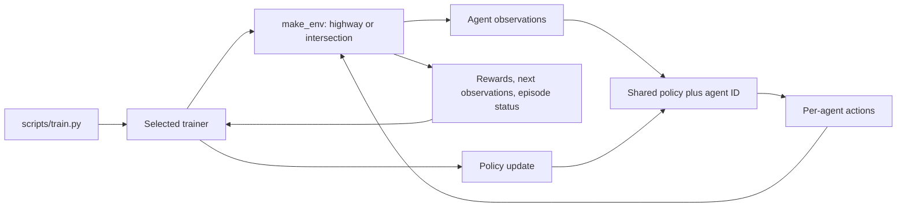

# Project architecture

## RL and MARL basics

In reinforcement learning (RL), an agent observes the environment, chooses an action, and receives a reward. Its policy maps observations to actions; training adjusts the policy to increase future reward. In multi-agent RL (MARL), several agents act in the same environment and can affect one another.

Here, each controlled vehicle is an agent. Background traffic is controlled by the environment. Agents share model parameters, and a one-hot agent ID lets the shared model distinguish them.

## Training and execution categories

- **CTDE:** centralized training, decentralized execution. Training can use information from all agents; each agent acts from its local observation.
- **CTCE:** centralized training and execution. A central controller combines information to choose agents' actions.
- **DTDE:** each agent learns from local information and acts from its local observation.

| Method | Category here | Reason |
| --- | --- | --- |
| MAPPO | CTDE | Shared actor uses each agent's local observation and ID. Centralized critic uses joint observations during training. |
| WocaR-DQN | CTDE with parameter sharing | Shared learner trains on agents' transitions. Each action uses that agent's observation and ID. It has no joint-state critic; CTDE does not require one. |
| WocaR-PPO | Single-agent | This implementation trains one continuous-control agent, so MARL categories do not apply. |

Shared weights do not make execution centralized. The key is whether action selection uses local or joint information.

## How components connect

MAPPO collects rollouts. Its shared actor selects each agent's actions; a centralized critic uses joint observations to train the actor. WocaR-DQN stores one transition per agent in a shared replay buffer, then updates its Q-networks from sampled transitions. The renderer receives policy weights and runs a separate episode.

## WocaR and the policies

WocaR adds robustness to a base learner by training against bounded observation changes. In DQN, `Q_r` selects actions; `Q_v` and its target learn standard DQN values; `Q_phi` estimates values under worst-case perturbations. `Q_r` is trained with a blend of standard and worst-case values plus a robustness regularizer.

The observation attack radius `--eps-final` differs from random-action exploration `--explore-final`. DQN's `kappa_wst` blend ends at `0.5` in the current code. WocaR-PPO uses a Gaussian actor, value critic, and `Q_phi` for continuous control.

## Environment and training details

| Environment | Per-agent observation | Actions | Reward behavior |
| --- | --- | --- | --- |
| Highway | 5 × 5 kinematics features; flattened size 25; relative coordinates | 5 discrete driving actions | Reward normalized to `[0, 1]`; team environment returns mean reward. |
| Intersection | 15 × 7 kinematics features; flattened size 105; absolute coordinates | 3 discrete speed choices | Raw reward scale; collision, speed, and arrival terms; one reward per agent. |

DQN appends an `N`-value one-hot agent ID, so each Q-network input has size `observation size + N`. Robust bounds assume observations are clipped to `[-1, 1]`; the perturbation mask currently includes `presence` features but excludes agent IDs.

Highway ends the team episode on a crash or configured off-road event. Intersection reports termination per agent for crash or arrival. DQN stores each agent's terminal flag and resets when all agents terminate or the time limit is reached. A finished agent currently keeps receiving actions while others continue.

## Code map

- [`scripts/train.py`](../scripts/train.py): command-line selection of training method and environment options.
- [`src/marl/env.py`](../src/marl/env.py): highway/intersection factories and observation helpers.
- [`src/marl/training/trainer.py`](../src/marl/training/trainer.py), [`src/marl/mappo.py`](../src/marl/mappo.py): MAPPO.
- [`src/marl/woca_r_rl/dqn.py`](../src/marl/woca_r_rl/dqn.py): WocaR-DQN and its replay buffer.
- [`src/marl/woca_r_rl/ppo.py`](../src/marl/woca_r_rl/ppo.py): WocaR-PPO.
- [`src/marl/rendering.py`](../src/marl/rendering.py): policy rendering and evaluation interface.
